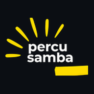
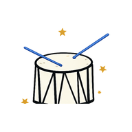
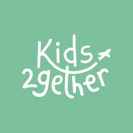

  <a href="https://ferreiradrope.github.io/">
    <picture>
      <source media="(prefers-color-scheme: dark)" srcset="assets/resumo-dark.svg">
      <source media="(prefers-color-scheme: light)" srcset="assets/resumo-light.svg">
      
    </picture>
  </a>

  
  
  

Sou engenheiro de software no Rio de Janeiro e trabalho com sistemas que já estão em produção: plataformas de pagamento, aplicativos nas lojas e automações com IA. No dia a dia uso **TypeScript, Node.js e Python**. Curso Ciência da Computação no IBMR.

Os repositórios dos produtos são privados, então aqui ficam os projetos abertos. No [portfólio](https://ferreiradrope.github.io/), cada item traz o passo a passo para conferir.

## Em produção

**Plataformas de matrícula e cobrança** para cinco escolas e oficinas de música, em Python/Flask e Next.js/TypeScript: matrícula on-line, cobrança recorrente por PIX, boleto e cartão, split de recebíveis, régua de inadimplência, conciliação por webhooks e NFS-e. Clique em uma para abrir:

  &nbsp;
  &nbsp;
  &nbsp;
  &nbsp;
  

<table>
  <tr>
    <td width="72" align="center"></td>
    <td><b>ScaleClock</b> Aplicativo de música com mais de 100 mil downloads. Recoloquei em funcionamento e mantenho o app em React Native e a API em Django com PostgreSQL.</td>
    <td width="110"><a href="https://play.google.com/store/apps/details?id=com.scaleclock">Google&nbsp;Play</a> <a href="https://apps.apple.com/br/app/scaleclock/id1464221197">App&nbsp;Store</a></td>
  </tr>
  <tr>
    <td align="center"></td>
    <td><b>Kids2gether</b> Aplicativo em React Native com back-end em Node.js no Firebase. Restabeleci login, pagamentos e e-mails e publiquei as versões novas nas duas lojas.</td>
    <td><a href="https://play.google.com/store/apps/details?id=com.kids2gether">Google&nbsp;Play</a> <a href="https://apps.apple.com/br/app/kids2gether/id1554942484">App&nbsp;Store</a></td>
  </tr>
  <tr>
    <td align="center"></td>
    <td><b>PraiAtiva</b> Plataforma de atividades físicas na praia, selecionada pelo Acelera Niterói. Fui um dos dois desenvolvedores da primeira versão, em React, TypeScript e Supabase.</td>
    <td><a href="https://www.praiativa.com/">praiativa.com</a></td>
  </tr>
  <tr>
    <td align="center"></td>
    <td><b>Ticket Baile</b> · em desenvolvimento Ticketaria para bailes, com ingressos em QR Code e painel de eventos e financeiro. Next.js, TypeScript e Firestore.</td>
    <td><a href="https://dev.ticketbaile.55jam.com.br/">ambiente&nbsp;de&nbsp;dev</a></td>
  </tr>
</table>

Também em produção: dois chatbots de WhatsApp com a API da OpenAI, n8n e Supabase, que consultam o conteúdo do site antes de responder, e integração contínua no GitHub Actions nos repositórios das plataformas.

## Código aberto

| Projeto | O que é | Stack |
|---|---|---|
| [PratoFácil](https://github.com/marciodosanjos/pratoFacil) | Sistema de pedidos para pequenos empreendedores, feito na faculdade em equipe de 13. Fui o principal contribuidor, com 40 de 44 commits. | Java 21, Spring Boot, PostgreSQL, JUnit 5, Docker |
| [MantovaniHub](https://github.com/ferreiradrope/MantovaniHub) | Sistema de produção, estoque e vendas de uma charcutaria, [publicado na Vercel](https://mantovanihub.vercel.app). Projeto de faculdade em equipe de 14. | Next.js, React, TypeScript, Supabase |
| [Kanban](https://github.com/ferreiradrope/kanban.app) | Um dos meus primeiros projetos: quadro kanban com a base gerada na Lovable, que eu empacotei com Docker e [publiquei](https://kanban-app-beta.vercel.app). | React, TypeScript, Docker |
| [Portfólio](https://github.com/ferreiradrope/ferreiradrope.github.io) | O código do meu [portfólio](https://ferreiradrope.github.io/), em página única e sem framework. | HTML, CSS, JavaScript |

## Stack

  

**Pagamentos:** Pagar.me, Asaas, Stripe, PIX, boleto, cartão, split e NFS-e 
**IA:** API da OpenAI, n8n, RAG e Claude Code no dia a dia

## Estudando agora

Node.js e PostgreSQL a fundo, testes, algoritmos e estruturas de dados, Docker, AWS e inglês.
