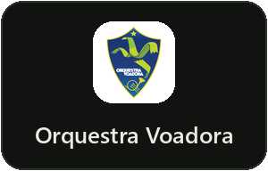
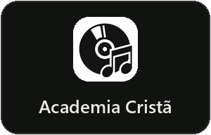
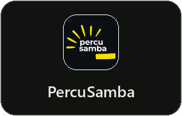
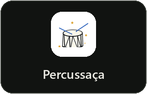
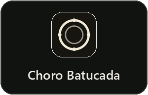
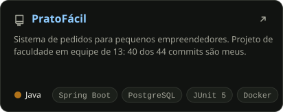
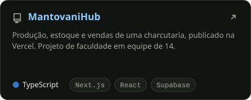
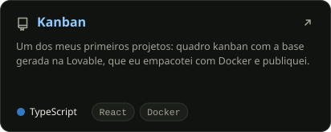
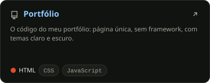

  

  &nbsp;
  &nbsp;
  

  Engenheiro de software no Rio de Janeiro. Trabalho com sistemas que já estão em produção: 
  plataformas de pagamento, aplicativos nas lojas e automações com IA.

## Em produção

<table>
  <tr>
    <td colspan="2">
      <b>Plataformas de matrícula e cobrança</b> para cinco escolas e oficinas de música 
      Matrícula on-line, cobrança recorrente por PIX, boleto e cartão, split de recebíveis, conciliação por webhooks e NFS-e. 
      <code>Python</code> <code>Flask</code> <code>Next.js</code> <code>TypeScript</code> <code>Firestore</code> <code>Pagar.me</code>
      

        
        
        
        
        
      

    </td>
  </tr>
  <tr>
    <td width="50%" valign="top">
      
      <b>ScaleClock</b> 
      Aplicativo de música com 100 mil+ downloads. Recuperei e mantenho o app e a API. 
      <code>React Native</code> <code>Django</code> <code>PostgreSQL</code> 
      <a href="https://play.google.com/store/apps/details?id=com.scaleclock">Google Play</a> · <a href="https://apps.apple.com/br/app/scaleclock/id1464221197">App Store</a>
    </td>
    <td width="50%" valign="top">
      
      <b>Kids2gether</b> 
      Aplicativo que voltou a funcionar para os assinantes, com versões novas nas duas lojas. 
      <code>React Native</code> <code>Node.js</code> <code>Firebase</code> 
      <a href="https://play.google.com/store/apps/details?id=com.kids2gether">Google Play</a> · <a href="https://apps.apple.com/br/app/kids2gether/id1554942484">App Store</a>
    </td>
  </tr>
  <tr>
    <td valign="top">
      
      <b>PraiAtiva</b> 
      Atividades físicas na praia, selecionada pelo Acelera Niterói. Um dos dois devs da primeira versão. 
      <code>React</code> <code>TypeScript</code> <code>Supabase</code> 
      <a href="https://www.praiativa.com/">praiativa.com</a>
    </td>
    <td valign="top">
      
      <b>Ticket Baile</b> · em desenvolvimento 
      Ticketaria para bailes, com ingresso em QR Code e painel de eventos e financeiro. 
      <code>Next.js</code> <code>TypeScript</code> <code>Firestore</code> 
      <a href="https://dev.ticketbaile.55jam.com.br/">ambiente de desenvolvimento</a>
    </td>
  </tr>
  <tr>
    <td valign="top">
      
      <b>Chatbots de WhatsApp com IA</b> 
      Dois chatbots que consultam o conteúdo do site do cliente antes de responder (RAG). 
      <code>API da OpenAI</code> <code>n8n</code> <code>Supabase</code>
    </td>
    <td valign="top">
      
      <b>Integração contínua e testes</b> 
      Lint, testes, build e auditoria de dependências a cada push nos repositórios das plataformas. 
      <code>GitHub Actions</code> <code>Vitest</code> <code>Python</code>
    </td>
  </tr>
</table>

> Os repositórios dos produtos são privados. No [portfólio](https://ferreiradrope.github.io/), cada item traz o passo a passo para conferir.

## Código aberto

  
  

  
  

## Stack

  

  

