

  

  &nbsp;
  &nbsp;
  

  Engenheiro de software no Rio de Janeiro. Trabalho com sistemas que já estão em produção: 
  plataformas de pagamento, aplicativos nas lojas e automações com IA.

## Em produção

  <a href="https://play.google.com/store/apps/details?id=com.scaleclock">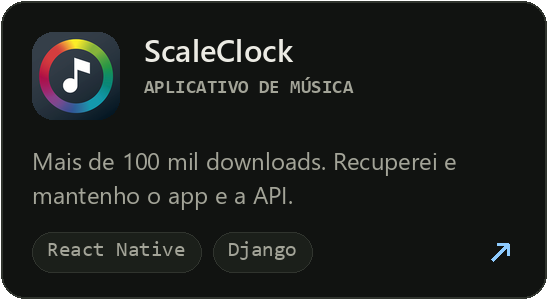</a>
  <a href="https://play.google.com/store/apps/details?id=com.kids2gether">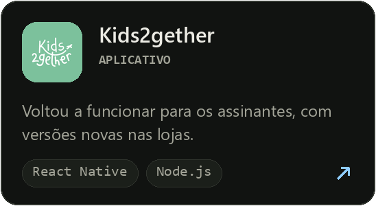</a>
  <a href="https://www.praiativa.com/">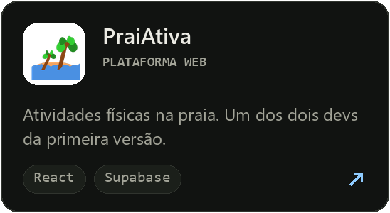</a>
  <a href="https://oficinaorquestravoadora2026.55jam.com.br">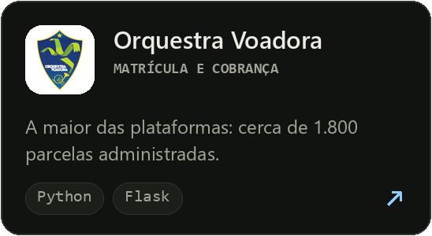</a>
  <a href="https://academiacrista.55jam.com.br">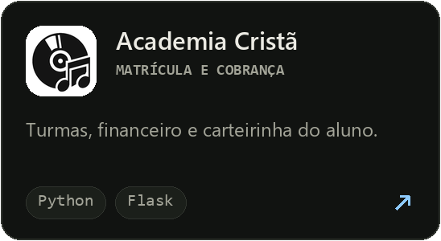</a>
  <a href="https://percusamba.55jam.com.br">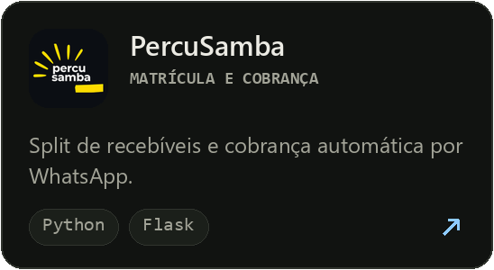</a>
  <a href="https://percussaca.55jam.com.br">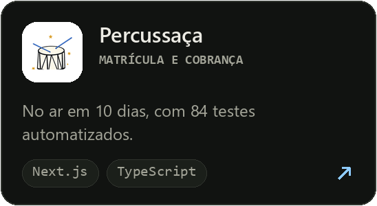</a>
  <a href="https://chorobatucada.55jam.com.br">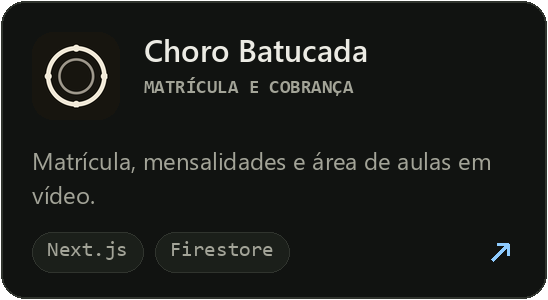</a>
  <a href="https://dev.ticketbaile.55jam.com.br/">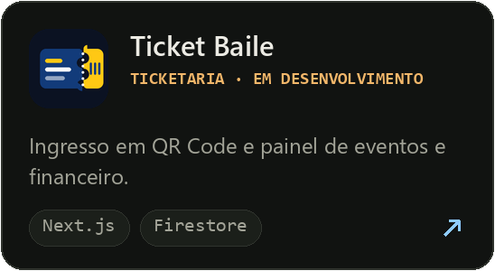</a>

> Os repositórios dos produtos são privados. No [portfólio](https://ferreiradrope.github.io/), cada item traz o passo a passo para conferir.

## Stack

  

  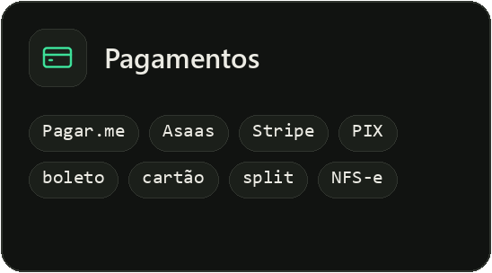
  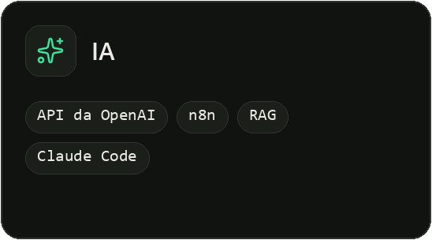
  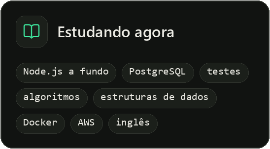

