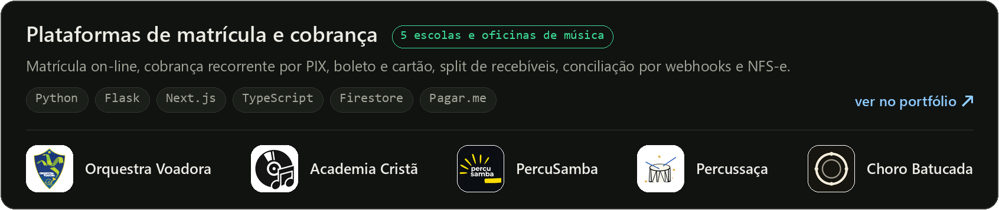
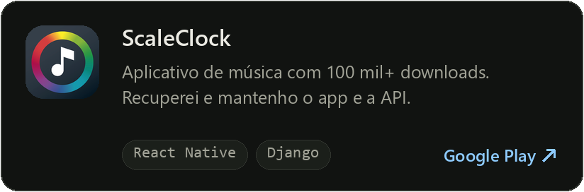
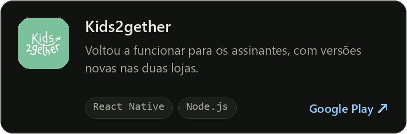
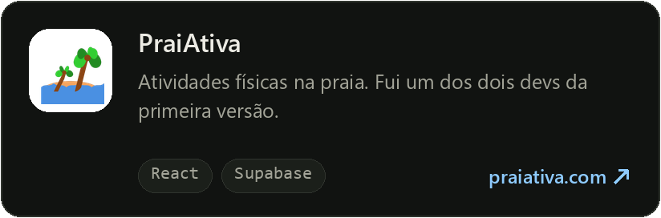
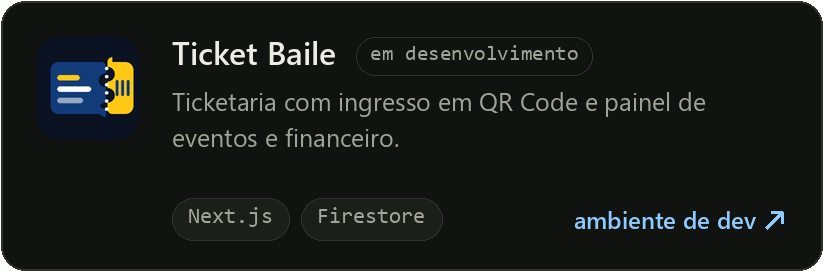
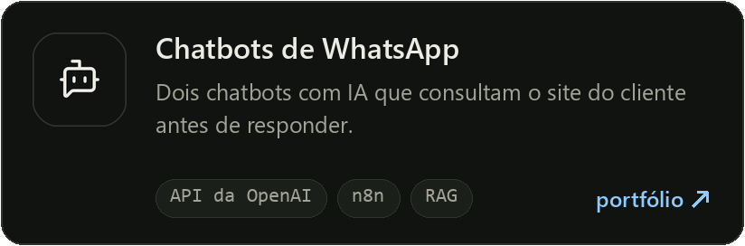
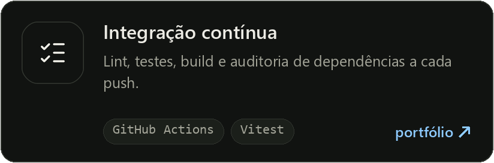
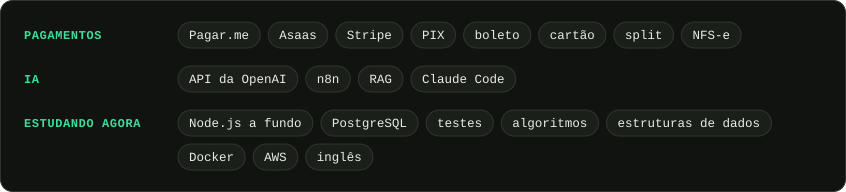

  

  &nbsp;
  &nbsp;
  

  Engenheiro de software no Rio de Janeiro. Trabalho com sistemas que já estão em produção: 
  plataformas de pagamento, aplicativos nas lojas e automações com IA.

## Em produção

  

  
  

  
  

  
  

> Os repositórios dos produtos são privados. No [portfólio](https://ferreiradrope.github.io/), cada item traz o passo a passo para conferir.

## Stack

  

  

